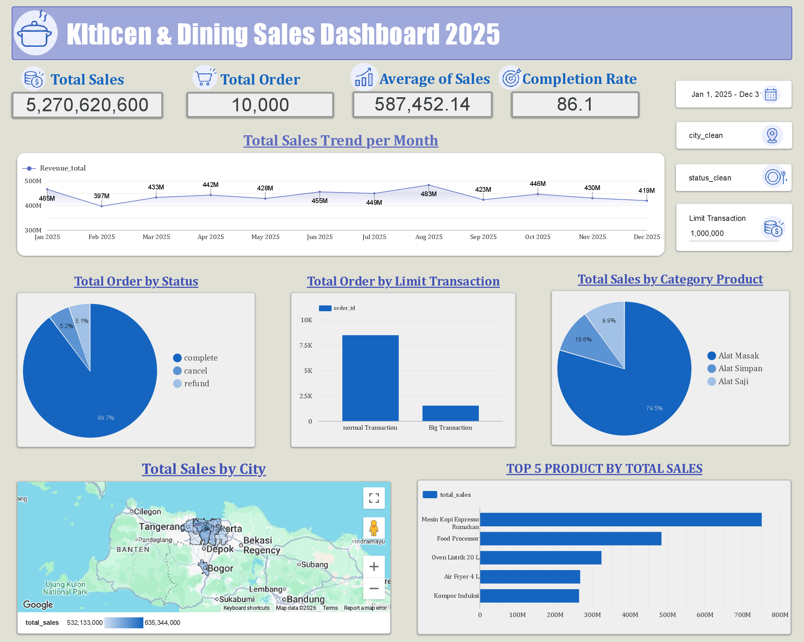

# Kitchen & Dining Sales Analysis Dashboard 2025

## 📌 Project Overview

This project analyzes kitchen and dining product sales to evaluate business performance, order completion, product category contributions, transaction limits, and sales distribution across cities.

The workflow includes data cleaning in Microsoft Excel, data storage and SQL-based analysis in Google BigQuery, and dashboard development to transform sales data into meaningful business insights.

## 🎯 Business Objectives

- Evaluate overall sales performance and order volume.
- Monitor order completion rates and identify cancelled or refunded transactions.
- Identify the best-performing product categories and products.
- Compare sales performance across cities.
- Analyze order distribution by transaction limit.
- Provide actionable recommendations to support business decision-making.

## ❓ Business Questions

1. What are the total sales, total orders, and average sales?
2. What is the monthly sales trend throughout 2025?
3. What percentage of orders are completed, cancelled, and refunded?
4. How are orders distributed between normal and big transactions?
5. Which product categories contribute the most to total sales?
6. Which cities generate the highest sales?
7. Which five products have the highest total sales?
8. What business opportunities can be identified from the sales data?

## 📂 Dataset

The dataset contains sales transaction records for kitchen and dining products, including information about orders, product names, product categories, shipping addresses, sales values, transaction limits, and order statuses.

- **Data Source:** Bootcamp Data Analyst Karirnex BATCH 6
- **Data Preparation:** Microsoft Excel
- **Data Storage & Analysis:** Google BigQuery
- **Dashboard Tool:** Google Looker Studio 

### Key Data Fields

The dataset includes fields related to:

- Order and transaction information
- Product names and sales values
- Product categories
- Shipping addresses and city information
- Order status
- Transaction limits

## 🧹 Data Cleaning & Preparation

Data cleaning was performed using Microsoft Excel before uploading the dataset to Google BigQuery.

1. **Standardizing Text Formatting**  
   Removed unnecessary leading, trailing, and excessive spaces to ensure consistent text values.

2. **Standardizing Capitalization**  
   Standardized capitalization across text fields to prevent inconsistent values caused by differences in letter case.

3. **Correcting Data Types**  
   Identified and corrected incorrectly formatted data types so that fields could be processed appropriately.

4. **Extracting City Information**  
   Extracted city names from the `shipping_address` column using Excel's **Text to Columns** feature and created a new `city` column for location-based analysis.

5. **Creating Product Categories**  
   Created a new category column based on predefined product classification rules.

   **Product categorization rules:**
   - [Insert category rule 1]
   - [Insert category rule 2]
   - [Insert category rule 3]

6. **Validating Cleaned Data**  
   Reviewed the cleaned data to ensure consistent formatting, appropriate data types, and accurate values before uploading it to BigQuery.

## 🗄️ Data Storage & Analysis with Google BigQuery

After data cleaning in Excel, the cleaned dataset was uploaded to Google BigQuery for further analysis.

SQL was used to perform basic data analysis, including:

- Calculating total sales and total orders.
- Calculating average sales.
- Analyzing monthly sales trends.
- Summarizing orders by status.
- Comparing normal and big transactions.
- Calculating sales by product category and city.
- Identifying the top five products by total sales.

These queries helped summarize the dataset and prepare the metrics required for the dashboard.

## 📊 Dashboard Overview

The dashboard provides an overview of kitchen and dining sales performance in 2025 through KPI cards, trend analysis, and visualizations.

### Key Dashboard Components

- **KPI Cards:** Total Sales, Total Order, Average of Sales, and Completion Rate.
- **Monthly Sales Trend:** Tracks changes in sales performance from January to December 2025.
- **Order Status Analysis:** Displays the distribution of completed, cancelled, and refunded orders.
- **Transaction Limit Analysis:** Compares normal transactions with big transactions.
- **Sales by Product Category:** Highlights the contribution of each product category.
- **Sales by City:** Visualizes the geographical distribution of sales.
- **Top 5 Products by Sales:** Identifies the products contributing the most to total sales.

### Dashboard Preview



LINK (https://datastudio.google.com/reporting/cfa00563-2be1-43e4-9b66-8abc7e079b1e)

## 💡 Business Insights

Based on the dashboard, the following insights were identified:

- **Overall Sales Performance:** Total sales reached approximately **IDR 5.87 billion** from **10,000 orders**, with average sales of approximately **IDR 587,269.93**.
- **Order Completion:** The completion rate reached **86.1%**, indicating an opportunity to investigate and reduce cancelled or refunded orders.
- **Product Category Performance:** **Alat Masak** contributed the largest share of sales at approximately **79.5%**, followed by Alat Simpan and Alat Saji.
- **Top-Selling Products:** Mesin Kopi Espresso Rumahan recorded the highest sales, followed by Food Processor and Oven Listrik.
- **Geographical Sales Distribution:** Sales were concentrated in several cities, highlighting opportunities to evaluate regional demand and develop targeted marketing strategies.
- **Transaction Distribution:** Normal transactions accounted for a larger order volume than big transactions, providing an opportunity to investigate strategies that encourage higher-value purchases.

## 🚀 Business Recommendations

1. **Improve Order Completion**  
   Investigate the causes of cancelled and refunded orders, such as stock availability, payment issues, and delivery problems, to improve the completion rate.

2. **Optimize Best-Selling Products**  
   Prioritize inventory planning and promotional campaigns for high-performing products while monitoring product availability and profit margins.

3. **Strengthen Product Category Strategy**  
   Maintain the availability of high-contributing categories while exploring opportunities to increase sales in lower-contributing categories through cross-selling and targeted promotions.

4. **Develop City-Based Marketing**  
   Use city-level sales performance to identify high-potential markets and tailor promotions, distribution, and delivery strategies to regional demand.

5. **Encourage Higher-Value Transactions**  
   Test product bundles, complementary product recommendations, and volume-based promotions to encourage customers to purchase additional items or choose big transactions.

## 🛠️ Tools & Technologies

- **Microsoft Excel** — Data cleaning, text standardization, data type correction, and city extraction.
- **Google BigQuery** — Dataset storage and SQL-based data analysis.
- **SQL** — Aggregation, grouping, filtering, and sales performance analysis.
- **Google Looker Studio** — KPI monitoring, trend analysis, and data visualization (update if needed).

## 📈 Key Skills Demonstrated

- Data Cleaning & Preparation
- Exploratory Data Analysis
- SQL Querying
- Google BigQuery
- KPI Development
- Sales Performance Analysis
- Data Visualization
- Business Insight Generation
- Data-Driven Recommendations

## 📁 Suggested Repository Structure

```text
Kitchen-Dining-Sales-Analysis/
├── data/
│   └── Toko Peralatan Dapur.csv
│   └── Toko Peralatan Dapur - Clean.csv
├── SQL/
│   └── Query.sql
├── kitchen-dining-sales-dashboard.png  
└── README.md
```

## 👤 Author

**Indah Marsya Fitadea

Aspiring Data Analyst

[GitHub Profile](https://github.com/indhmrsyaa)
